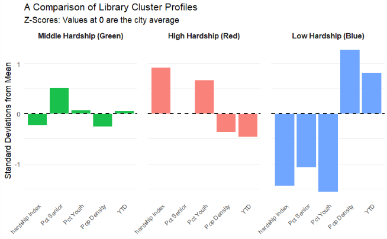
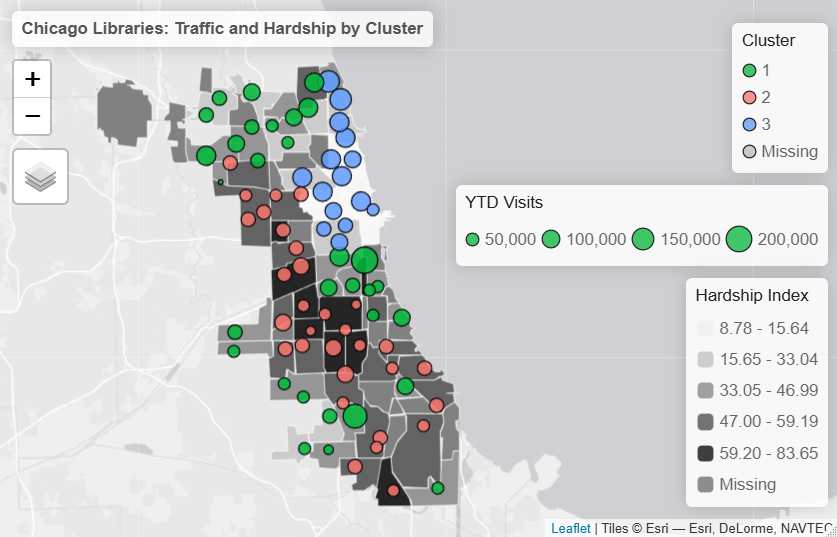

## Evaluating Neighborhood Equity in Chicago's Library System

May 2026

This project examines how socioeconomic hardship affects library
visits across Chicago neighborhoods from 2013 to 2023. I used random
forest modeling and k-means clustering in R to identify factors associated
with library visitation and explore geographic disparities in library
access across Chicago communities.

<a href="projects/ml_report2025.pdf"
   target="_blank"
   rel="noopener noreferrer"
   class="btn btn-primary">
  Download Full Report (PDF)
</a>

::: {.panel-tabset}

### Exploratory Data Analysis
{width=62%}

### Cluster Insights
{width=57%}

### Chicago Map
{width=62%}

:::

---

## Engagement Report

August 2025

This report examines conference attendance and feedback in London,
Washington, D.C., and Toronto to identify trends in engagement and
attendee experience. I used Microsoft Excel to analyze the data and
identify patterns, then created visualizations in Canva to communicate
the findings effectively.

This project demonstrates my skills in data analysis, trend
identification, and visual storytelling to support decision-making.

<a href="projects/encc_report.pdf"
   target="_blank"
   rel="noopener noreferrer"
   class="btn btn-primary">
  Download Full Report (PDF)
</a>

<iframe
  src="projects/encc_report.pdf"
  width="100%"
  height="800"
  style="border: none;">
</iframe>